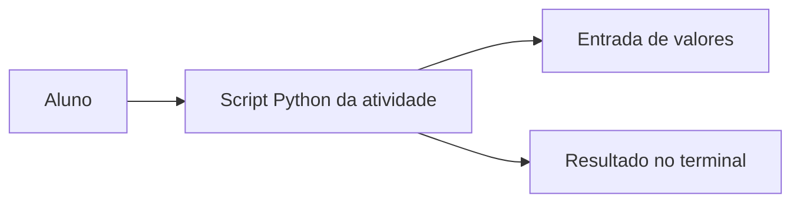

# Estrutura — Atividade2-EdN

Cada script é independente. Não existe uma arquitetura em camadas obrigatória neste laboratório.

Arquivos: conversorDeMoeda.py, calculadoraDesconto.py, calculadoraMediaEscolar.py, calculadoraConsumoCombustivel.py, calciuladoraSalarioPorHora.py.
